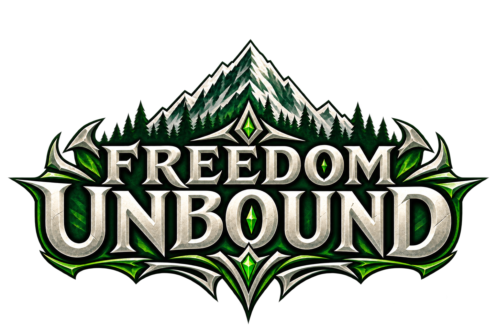
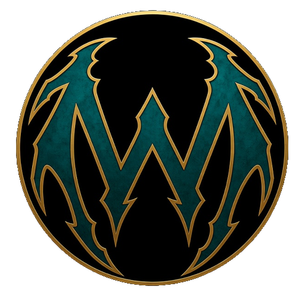

  

# Freedom Unbound

 Created by Team Wyvern Works

A Windows native recompilation of **Monster Hunter Freedom Unite**, built on [PortableKit](https://github.com/TeamGDB/PortableKit).

Play Freedom Unite on PC with a dedicated launcher, configurable controls, save management and optional mods. You need your own supported USA copy of the game; game files and saves are not included.

## Current stage — 16 October 2026

**Playable alpha.** Various Village Elder quests have been tested through **★3**, including progression, hunting, saving and reloading. The full game is expected to be playable, but a complete playthrough has not yet been verified.

Current features:

- Native PC gameplay at the original **30 FPS**, with optional experimental interpolation.
- A dedicated launcher with English and Brazilian Portuguese interface options.
- Three save cards with rotatable equipped hunters, equipment details, rank, Zenny, Pokke/Guild Points and play time.
- A **Load** button for each occupied card to start that hunter.
- Automatic and manual save backups, restore, and compatible PSP save import/export.
- Configurable keyboard, mouse and gamepad controls.
- Optional texture, text and supported gameplay mods.
- Optional cheats for progression testing.
- Screenshots, update checks and a built-in bug report tool.

**Known issues:** experimental interpolation can distort the background inside the hunter's house. Use 30 FPS if this happens. Brief loading hitches may occur. Multiplayer and compatibility across different PCs still need testing. The **Fill** display option is not yet available.

## Next steps

1. Broaden testing across quests, weapons, monsters, maps and different PCs.
2. Fix reported gameplay, save and stability issues.
3. Improve interpolation, loading and launcher usability.
4. Work toward multiplayer and native 60 FPS gameplay.
5. Consider support for more platforms.

These are development goals, with no confirmed release dates.

## Planned content and optional mods

Find my Freedom Unite mods, downloads and installation guides in [Freedom Unbound Mods](https://github.com/Dudux42/FreedomUnboundmods).

| Mod support | What it does |
| --- | --- |
| Texture packs | Replace supported game textures, including HD artwork. Enable one texture pack at a time. |
| Text mods | Replace supported game text and fonts. The launcher's language setting is separate from the game's translation. |
| Gameplay and HUD mods | Add supported features such as damage numbers, gathering indicators, monster health, camera controls and key-quest markers. These require a compatible launcher version. |

To install a mod, download its ZIP and **do not extract it**. Drop it onto the launcher's **Mods** page, review the details, choose **Install**, then turn it on.

Mods are downloaded separately. Check each mod's guide for launcher requirements, controls and known limitations. Some mods change saved progress.

Want to build your own? Read [Modding Freedom Unbound](MODDING.md). For native gameplay and overlay providers, see [Native Overlay Support](NATIVE_OVERLAY_SUPPORT.md).

## Build and play

Download the Windows x64 ZIP from the [release page](https://github.com/Dudux42/FreedomUnbound/releases). Choose the playable package under **Assets**, rather than GitHub's automatic Source code download.

**Requirements:** Windows x64, a Vulkan-capable GPU and driver, an AVX-capable CPU, the Microsoft Visual C++ x64 runtime, and **A LEGALLY OBTAINED DUMP of Monster Hunter Freedom Unite — USA version (`ULUS10391`), in ISO format**. You must supply your own dump; game files are not included.

1. Extract the complete ZIP into a writable folder.
2. Keep all extracted files together and run **`FreedomUnbound.exe`**.
3. Follow first-run setup and select your supported USA ISO.
4. Adjust your settings, then choose **Play**. If you already have a hunter, you can use its **Load** button.

Do not run the game from inside the ZIP or copy only the launcher executable. `Start-Freedom-Unbound.cmd` is available as a fallback.

**Settings**

| Setting | Explanation |
| --- | --- |
| Resolution | Auto follows the window size. ×1–×6 increase internal resolution; higher values give a sharper image and require more GPU power. |
| Fullscreen / Window size | Choose fullscreen or a resizable window and set its starting size. |
| Aspect ratio | Original preserves the PSP picture's proportions. Stretch fills the window by stretching it. Fill is not yet available. |
| Scaling filter | Sharp preserves hard pixel edges; Smooth softens the image when it is resized to the window. |
| Texture filter | Choose sharper or smoother sampling of the game's textures. |
| Vsync | Synchronizes presentation with your display to reduce tearing. |
| Frame rate | Gameplay runs at 30 FPS. Higher presentation rates use experimental interpolation; they do not make gameplay native 60 FPS. |
| Lower when behind | Automatically reduces the presentation rate if the chosen rate would slow the game. |
| Game speed | Normal keeps the game at its intended speed. Unlimited lets it run faster where possible. |
| Fast loading | Allows faster processing during supported silent loading sections. |
| Performance | Shows FPS and performance information. F3 toggles the on-screen display. |
| Audio | Adjust overall volume or mute without losing your volume setting. |
| Button bindings | Remap supported keyboard, mouse and gamepad buttons under Controls. |
| Sticks and triggers | Adjust stick dead zones and the trigger activation point. Higher dead zones help prevent drift. |
| Camera | Configure right-stick behavior, supported camera options, speed, inversion and axis swapping. Some camera features require the matching mod. |
| Mouse | Enable mouse control and adjust sensitivity and inversion. |
| Confirm button | Choose the bottom or right face button for confirmation. |
| Name entry | Choose the on-screen keyboard or a preset name when the game requests one. |
| Touch controls | Adjust on-screen controls, size, opacity and camera speed when using a touch screen. |
| Language | Choose English, Brazilian Portuguese or automatic selection for the launcher and host menus. This does not translate the entire game. |
| Restore defaults | Reset the settings on the selected page. |

**Useful controls:** Esc or L3+R3 opens the in-game menu; F3 toggles performance information; F12 takes a screenshot. The launcher can open your screenshots folder.

Use **Saves** to manage backups, restore or import/export a compatible save. Keep a separate copy of your original PSP save and follow any restart prompts.

Optional **Cheats** include unlimited health/stamina, one-hit kills, maximum Zenny, item-box stack multiplication, free crafting for available recipes and L+R quest completion. Some cheats require a restart after disabling. Money, items, crafted equipment and saved progress are not undone when a cheat is turned off.

To report a problem, use **Report a bug** in the launcher and share the report through the server's bug-report channel. Include what happened and how to reproduce it. The report excludes your saves, save keys and game files.

## Project documentation

- [Freedom Unbound Mods](https://github.com/Dudux42/FreedomUnboundmods): my FU mods, downloads and player guides.
- [MODDING.md](MODDING.md): how to create compatible mod packages.
- [NATIVE_OVERLAY_SUPPORT.md](NATIVE_OVERLAY_SUPPORT.md): support for native gameplay and overlay providers.

## Credits

- **Team Wyvern Works / DuduX42:** Freedom Unbound and its launcher.
- **PortableKit and PSPRecomp contributors:** the recompilation framework and runtime that make this project possible. See [PortableKit](https://github.com/TeamGDB/PortableKit).
- **Capcom:** the original Monster Hunter Freedom Unite and Monster Hunter series.
- **Third-party library contributors:** SDL, FFmpeg, Dear ImGui, Vulkan Loader, miniz, stb, tiny-AES and xxHash. Their license notices are included with the Windows package.
- **Our playtesters and community:** testing, bug reports and feedback.

Freedom Unbound is an unofficial fan project and is not affiliated with or endorsed by Capcom.

